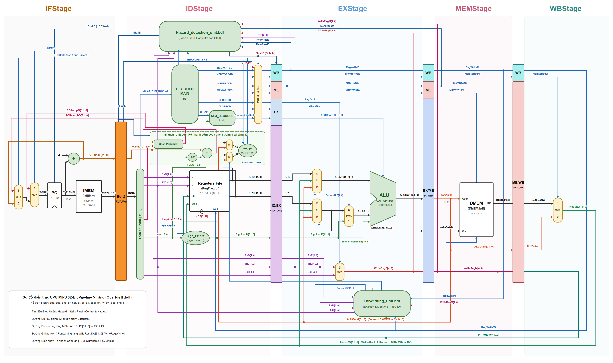
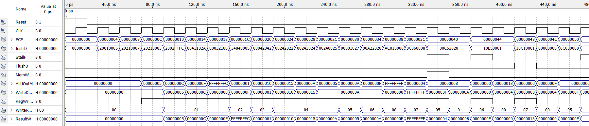
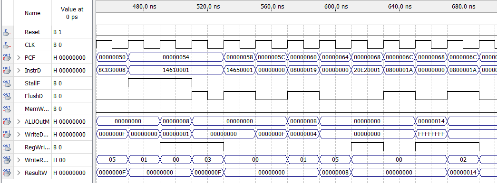
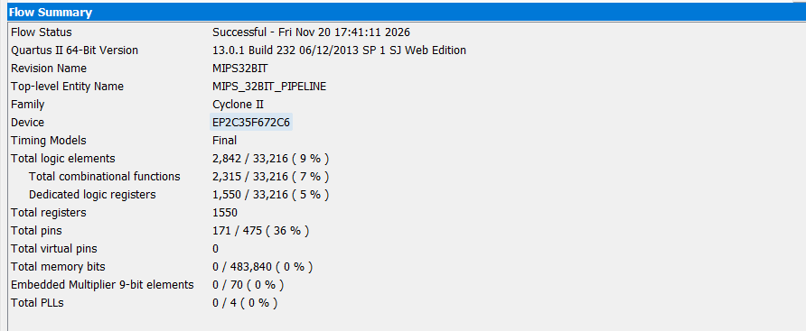

# 32-bit 5-Stage Pipelined MIPS CPU (FPGA Cyclone II)

Đồ án môn học **CE118 – Thiết kế Luận lý Số (Digital Logic Design)**, Khoa Kỹ thuật Máy tính, Trường Đại học Công nghệ Thông tin – ĐHQG TP.HCM (UIT).

Thiết kế, hiện thực mức cổng luận lý (`.bdf` Schematic kết hợp Verilog HDL) và kiểm chứng bộ vi xử lý **MIPS 32-bit Pipeline 5 tầng (`IF`, `ID`, `EX`, `MEM`, `WB`)** trên **Intel/Altera Quartus II 13.0 SP1**.

---

## 1. Kiến trúc tổng thể



### Các đặc điểm kỹ thuật nổi bật
- **15 lệnh cốt lõi + `nop`** thuộc đủ 3 định dạng:
  - **R-Type:** `add`, `sub`, `and`, `or`, `nor`, `slt`, `sll`, `srl`, `nop`
  - **I-Type:** `addi`, `ori`, `lw`, `sw`, `beq`, `bne`
  - **J-Type:** `j`
- **Bộ cộng nhìn trước nhớ phân cấp 2 tầng (`CLA_4bit` + `LCU_16bit`)** trong `ALU_32bit.bdf`: rút ngắn độ trễ truyền nhớ 32-bit từ 32 mức cổng xuống 6 mức cổng logic.
- **Khối chuyển tiếp dữ liệu (`Forwarding_Unit.bdf`):**
  - Giải quyết xung đột RAW đơn (`EX/MEM → EX`, `MEM/WB → EX`), xung đột kép (*Double Data Hazard* ưu tiên `MEM`), và chuyển tiếp về tầng `ID` (`ForwardAD`, `ForwardBD`).
  - Bảo vệ cứng thanh ghi `$0 = 0` (`EN = GND` tại `RegFile` kết hợp `NonZero` trong `Forwarding_Unit`).
- **Tập thanh ghi ghi sườn xuống (`CLK_N = NOT(CLK)`):** Tự động hóa chu trình ghi nửa đầu – đọc nửa sau chu kỳ, giải quyết xung đột `WB–ID`.
- **Khối phát hiện xung đột (`Hazard_detection_unit.bdf`) & Rẽ nhánh sớm (`Branch_Unit.bdf`):**
  - Tự động chèn Stall 1 nhịp cho `Load-Use` và `ALU-Branch`, Stall kép 2 nhịp cho `Load-Branch`.
  - Quyết định rẽ nhánh sớm ngay tại tầng `ID`, giảm *Branch Penalty* xuống **1 chu kỳ (`FlushD`)**.

---

## 2. Kết quả mô phỏng dạng sóng (Quartus II `.vwf`)

Chương trình kiểm thử toàn diện 27 lệnh (`asm/test_toan_dien.asm`, nạp qua `asm/binary.txt`) kiểm chứng đầy đủ 15/15 lệnh, Forwarding, Double Data Hazard, bẫy ghi `$0`, Load-Use Stall, ALU-Branch Stall, Load-Branch Stall kép 2 chu kỳ, `beq`/`bne`/`j` Flush và kết quả chốt cuối cùng **`$2 = 0x00000014` (`20`)** tại chu kỳ `CC33`:

### Giai đoạn `0 ns – 470 ns`


### Giai đoạn `450 ns – 700 ns`


---

## 3. Tài nguyên FPGA & Hiệu năng (Cyclone II `EP2C35F672C6`)



| Chỉ số kỹ thuật | Kết quả thực nghiệm | Ghi chú |
| :--- | :---: | :--- |
| **Total Logic Elements** | **2.842 / 33.216 (9%)** | `2.315` Combinational + `1.550` Registers |
| **Dedicated Logic Registers** | **1.550 / 33.216 (5%)** | Khớp phân tích lý thuyết |
| **Total Pins** | **171 / 475 (36%)** | 2 Input + 169 Output |
| **Tần số tối đa ($f_{\max}$ – Slow Model)** | **62,54 MHz** | $T_{\min} = 15,99\text{ ns}$ (TimeQuest) |
| **Chu kỳ hoàn thành (23 lệnh thực thi)** | **34 chu kỳ** | `4` Fill + `23` Exec + `4` Stall + `3` Flush |
| **CPI trung bình** | **1,48 chu kỳ/lệnh** | $T_{\text{exec}} = 543,66\text{ ns}$ tại $f_{\max}$ |
| **Hệ số tăng tốc (Speedup vs Single-Cycle)** | **2,64×** | So với mốc Single-Cycle tham chiếu `~16 MHz` |

---

## 4. Cấu trúc thư mục dự án

```text
MIPS-32bit-Pipeline-CPU/
├── quartus/                  # Dự án Quartus II 13.0 SP1 (.bdf, .v, .qip, .qpf, .qsf, .vwf)
├── asm/                      # Chương trình hợp ngữ kiểm thử & mã máy 32-bit
│   ├── test_toan_dien.asm    # Golden benchmark 27 lệnh
│   ├── binary_full_test.txt  # Mã máy nhị phân 32-bit (27 lệnh)
│   └── binary.txt            # Bản đồng bộ dùng trực tiếp cho IMEM.v
├── verilog_sim/              # Mô hình Verilog HDL tham khảo & testbench (ModelSim)
├── report/                   # Báo cáo đồ án LaTeX (.tex), PDF hoàn chỉnh & toàn bộ hình ảnh
│   ├── Bao_Cao_Do_An_MIPS32_Pipeline_Overleaf.pdf
│   └── Bao_Cao_Do_An_MIPS32_Pipeline_Overleaf.tex
├── .gitignore                # Tự động lọc file tạm Quartus, ModelSim, LaTeX
└── README.md
```

---

## 5. Tác giả
- **Sinh viên thực hiện:** Nguyễn Hữu Danh – MSSV: `25520251`
- **Giảng viên hướng dẫn:** ThS. Hồ Ngọc Diễm
- **Môn học:** CE118.R14 – Thiết kế Luận lý Số, UIT – ĐHQG TP.HCM
